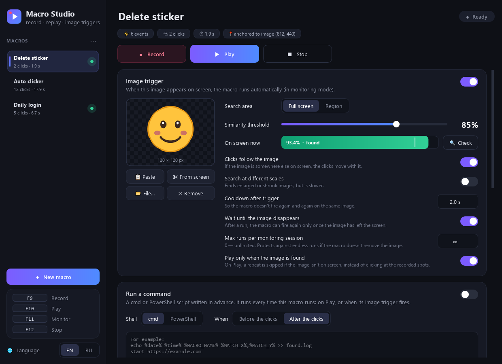

# Macro Studio

**English** · [Русский](README.ru.md)

A Windows macro recorder that can also **react to what's on screen**. Record your mouse clicks, movements and keystrokes, then replay them on demand, or automatically when a chosen image shows up on screen. A macro can also run a terminal command you've written in advance.

**[⬇ Download MacroStudio.exe](https://github.com/araluga/macro-studio/releases/latest)**: one file for Windows 10/11, nothing to install.



## Features

- **Record and replay** mouse clicks, movement, scrolling and (optionally) the keyboard.
- **Repeats, speed, delay:** loop a macro N times or forever, at 0.25×–5× speed, or replay only the clicks without the mouse path.
- **Image triggers:** give a macro a picture (paste, drag & drop, open a file, or snip it straight from the screen). In monitoring mode, the macro runs as soon as that picture appears with a similarity above your threshold.
- **Terminal commands:** a macro can run a cmd or PowerShell script before or after its clicks, or on its own with no clicks at all. The command gets the match position as variables (`%MATCH_X%`, `%MATCH_Y%`, …).
- **Clicks follow the image:** if the picture shows up somewhere else on screen, the recorded clicks are shifted to match.
- **Search area:** look for the picture on the whole screen (all monitors) or only in a selected region.
- **Transparency-aware matching:** transparent pixels (e.g. a sticker's background) are ignored.
- **Multi-scale search:** optionally finds the picture even when it's enlarged or shrunk.
- **Live feedback:** a similarity meter, a "Check" button that outlines the match on screen, and a floating status pill. The pill lets clicks pass through and is excluded from screenshots, so it never confuses the search.
- **Several macros at once:** monitoring watches every macro that has a trigger enabled, using one screenshot per cycle.
- **No runaway loops:** a cooldown, "wait until the image disappears" and a per-session run limit keep a macro from firing again and again if it didn't remove the image.
- **No blind clicks:** on Play, a macro with an image trigger can skip repeats while its image isn't on screen, instead of clicking at the recorded spots.
- **Reliable stop:** a configurable hotkey, a click on the tray icon, or moving the mouse into the top-left screen corner. The last two work even when an admin window has focus and hotkeys can't be seen.
- **Configurable hotkeys:** they're kept away from other apps, so F11 won't also toggle your browser's full screen.
- **English and Russian UI:** switch the language in the sidebar.
- Everything is saved automatically. Macros can be exported and imported as JSON.

## Example: auto-delete a Telegram sticker

1. Create a macro called "Delete sticker".
2. Copy the sticker (right-click → Copy, or `Win+Shift+S`) and press **Ctrl+V** in the app. You can also drop an image file or click **From screen** and select the sticker.
3. Choose where to look: **Full screen** or a **Region**, and set the similarity threshold (e.g. 85%). Press **Check** to see the current similarity and where the match is.
4. With the sticker visible, record the actions: **F9** → right-click the sticker → Delete → **F9**. When recording starts, the app remembers where the sticker was.
5. Press **F11** to start monitoring. Whenever the sticker appears, the macro deletes it, even if it's in a different place.

## Running a command on an image trigger

Open the **Run a command** card of a macro, turn it on and write the command. A macro doesn't need any recorded clicks: a command-only macro with an image trigger simply runs the command whenever the image appears.

- **Shell:** `cmd` or `PowerShell`. Multi-line scripts are fine.
- **When:** before or after the recorded clicks.
- **Wait until it finishes:** the output and exit code go to the log, and the stop key ends a long command. Turn it off to start the command in the background.
- **Show the console window:** off by default, so the command runs hidden.
- **Test the command** runs it right away.

Variables you can use:

| Variable | Value |
|----------|-------|
| `MACRO_NAME` | Macro name |
| `MATCH_FOUND` | `1` if the image was found, `0` otherwise |
| `MATCH_X`, `MATCH_Y` | Center of the found image, in screen pixels |
| `MATCH_W`, `MATCH_H` | Size of the found image |
| `MATCH_SCORE` | Similarity in %, e.g. `93.4` |

In cmd you write `%MATCH_X%`, in PowerShell `$env:MATCH_X`. For example:

```bat
echo %date% %time% %MACRO_NAME% at %MATCH_X%,%MATCH_Y% >> found.log
start https://example.com
```

Commands run in your user folder with your account's rights. Commands in **imported** macros are switched off until you review them and turn them back on.

## Hotkeys (global)

Defaults are below. Click a key in the sidebar to change it (F1–F12, Pause, Scroll Lock, Insert, Home, End, Page Up/Down).

| Key | Action |
|-----|--------|
| `F9`  | Start / stop recording |
| `F10` | Play the selected macro |
| `F11` | Start / stop monitoring |
| `F12` | Stop |

**Fallback stops:** click the tray icon, or move the mouse into the top-left corner of the screen. You can turn the corner stop off in the Monitoring card.

## Download

Grab **`MacroStudio.exe`** from the [latest release](https://github.com/araluga/macro-studio/releases/latest). It's a single file with nothing to install. Just run it (Windows 10/11, 64-bit).

- Windows SmartScreen may warn about an unknown publisher because the exe isn't code-signed. Click **More info → Run anyway**.
- Some antivirus tools flag any app that listens to the keyboard and mouse. That's how hotkeys and recording work. The source is all here, so you can also run it from source or build it yourself (see below).
- The exe keeps your macros and settings in `%APPDATA%\MacroStudio`.

## Run from source

Requires **Windows 10/11** and **Python 3.10–3.13**. Dependency versions are pinned in `requirements.txt`.

```bash
git clone https://github.com/araluga/macro-studio.git
cd macro-studio
pip install -r requirements.txt
python macro_app.py
```

Or just double-click **`run.bat`**. It installs the dependencies on first launch and starts the app without a console window.

### Build the exe

```bash
build.bat
```

This creates `dist\MacroStudio.exe` with [PyInstaller](https://pyinstaller.org/) (see `MacroStudio.spec`).

## How it works

| File | Purpose |
|------|---------|
| `macro_app.py` | User interface (PySide6 / Qt) |
| `core.py` | Recording and playback ([pynput](https://github.com/moses-palmer/pynput)), screen capture ([mss](https://github.com/BoboTiG/python-mss)), template matching ([OpenCV](https://opencv.org/) `TM_CCOEFF_NORMED`) |
| `i18n.py` | English / Russian translations |

Macros are stored in `macros.json` and app settings in `settings.json`: next to the script when run from source, in `%APPDATA%\MacroStudio` for the exe. A backup, `macros.json.bak`, is made once per session. If `macros.json` can't be read, it's renamed to `macros.corrupt-<date>.json` instead of being overwritten.

## Notes

- Use macros responsibly: automating some games or services may break their terms of use.
- Apps running as administrator can only be controlled, and only see hotkeys, when Macro Studio also runs as administrator. The tray icon and the corner stop always work.

## License

[MIT](LICENSE)
