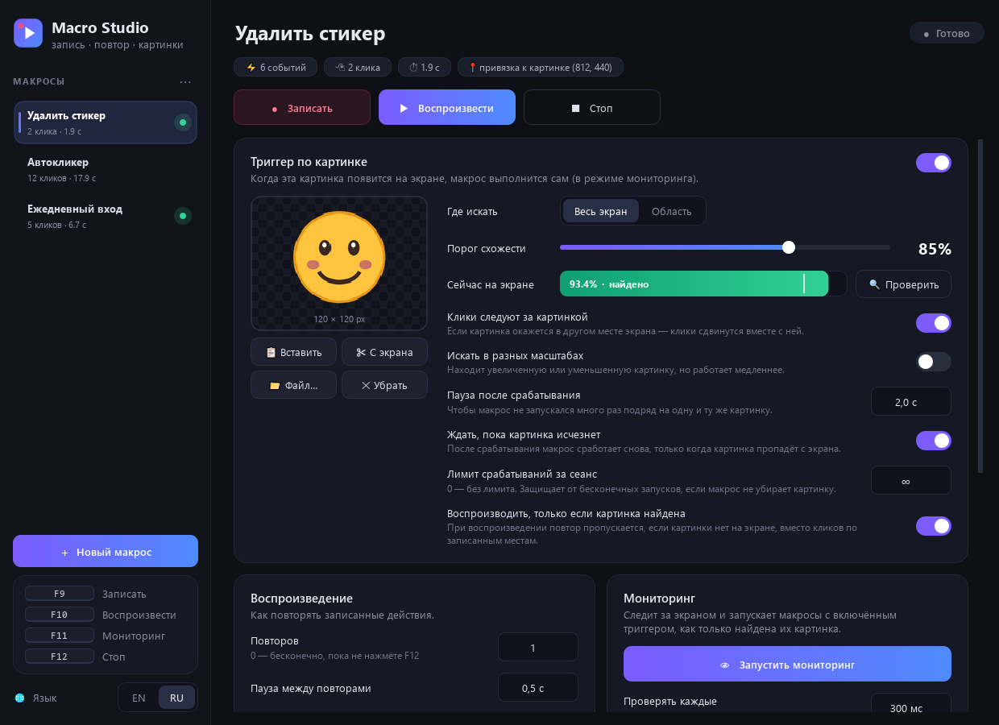

# Macro Studio

[English](README.md) · **Русский**

Программа для записи макросов в Windows, которая умеет **реагировать на то, что происходит на экране**. Записывает клики, движения мыши и нажатия клавиш, а потом повторяет их по команде или сама, когда на экране появляется нужная картинка.

**[⬇ Скачать MacroStudio.exe](https://github.com/araluga/macro-studio/releases/latest)**: один файл для Windows 10/11, установка не нужна.



## Возможности

- **Запись и повтор** кликов, движений и прокрутки мыши, а по желанию и клавиатуры.
- **Повторы, скорость, пауза:** макрос можно повторить N раз или бесконечно, со скоростью от ×0,25 до ×5, или повторять только клики без пути мыши.
- **Триггер по картинке:** макросу можно задать картинку — вставить, перетащить, открыть файлом или вырезать прямо с экрана. В режиме мониторинга макрос запускается, как только картинка появится на экране со схожестью выше порога.
- **Клики следуют за картинкой:** если картинка появилась в другом месте экрана, записанные клики сдвигаются вместе с ней.
- **Где искать:** на всём экране (все мониторы) или только в выбранной области.
- **Учёт прозрачности:** прозрачные пиксели (например, фон стикера) не сравниваются.
- **Поиск в разных масштабах:** по желанию находит картинку, даже если она увеличена или уменьшена.
- **Наглядность:** шкала схожести, кнопка «Проверить», которая обводит найденное место на экране, и плавающая плашка-индикатор. Плашка пропускает клики насквозь и не попадает на скриншоты, поэтому не мешает поиску.
- **Несколько макросов сразу:** мониторинг следит за всеми макросами с включённым триггером и делает один снимок экрана на цикл.
- **Без бесконечных повторов:** пауза после срабатывания, режим «ждать, пока картинка исчезнет» и лимит срабатываний за сеанс не дают макросу запускаться снова и снова, если он не убрал картинку.
- **Без кликов вслепую:** при воспроизведении макрос с триггером может пропускать повторы, пока картинки нет на экране, вместо кликов по записанным местам.
- **Надёжная остановка:** настраиваемая клавиша, клик по значку в трее или мышь в левый верхний угол экрана. Последние два способа работают, даже когда в фокусе окно администратора и горячие клавиши не видны.
- **Настраиваемые горячие клавиши:** они не доходят до других программ, так что F11 больше не переключает полноэкранный режим в браузере.
- **Английский и русский интерфейс:** язык переключается в боковой панели.
- Всё сохраняется автоматически, макросы можно экспортировать и импортировать в JSON.

## Пример: автоудаление стикера в Telegram

1. Создайте макрос «Удалить стикер».
2. Скопируйте стикер (ПКМ → Копировать или `Win+Shift+S`) и нажмите **Ctrl+V** в программе. Ещё можно перетащить файл картинки или нажать **«С экрана»** и выделить стикер.
3. Выберите, где искать: **«Весь экран»** или **«Область»**, и задайте порог схожести (например, 85%). Кнопка **«Проверить»** покажет текущую схожесть и место совпадения.
4. Пока стикер виден, запишите действия: **F9** → ПКМ по стикеру → «Удалить» → **F9**. В начале записи программа запоминает, где был стикер.
5. Нажмите **F11**, чтобы включить мониторинг. Как только стикер появится, макрос удалит его, даже если он окажется в другом месте.

## Горячие клавиши (работают из любого окна)

Ниже клавиши по умолчанию. Чтобы сменить, нажмите на клавишу в боковой панели (F1–F12, Pause, Scroll Lock, Insert, Home, End, Page Up/Down).

| Клавиша | Действие |
|---------|----------|
| `F9`  | Начать / остановить запись |
| `F10` | Воспроизвести выбранный макрос |
| `F11` | Включить / выключить мониторинг |
| `F12` | Стоп |

**Запасные способы остановки:** клик по значку в трее или мышь в левый верхний угол экрана. Остановку через угол можно выключить в карточке «Мониторинг».

## Скачать

Скачайте **`MacroStudio.exe`** из [последнего релиза](https://github.com/araluga/macro-studio/releases/latest). Это один файл, устанавливать ничего не нужно — просто запустите его (Windows 10/11, 64-бит).

- Windows SmartScreen может предупредить о неизвестном издателе, потому что exe не подписан. Нажмите **«Подробнее» → «Выполнить в любом случае»**.
- Некоторые антивирусы ругаются на любые программы, которые отслеживают клавиатуру и мышь. Именно так работают горячие клавиши и запись. Весь исходный код открыт, так что программу можно запустить из исходников или собрать самому (см. ниже).
- Exe хранит макросы и настройки в `%APPDATA%\MacroStudio`.

## Запуск из исходников

Нужны **Windows 10/11** и **Python 3.10–3.13**. Версии зависимостей зафиксированы в `requirements.txt`.

```bash
git clone https://github.com/araluga/macro-studio.git
cd macro-studio
pip install -r requirements.txt
python macro_app.py
```

Или просто дважды щёлкните **`run.bat`**: при первом запуске он сам установит библиотеки и откроет программу без окна консоли.

### Собрать exe

```bash
build.bat
```

Появится `dist\MacroStudio.exe`, собранный через [PyInstaller](https://pyinstaller.org/) (настройки в `MacroStudio.spec`).

Язык интерфейса по умолчанию английский. Чтобы переключить на русский, нажмите **RU** внизу боковой панели.

## Как устроено

| Файл | Назначение |
|------|------------|
| `macro_app.py` | Интерфейс (PySide6 / Qt) |
| `core.py` | Запись и повтор ([pynput](https://github.com/moses-palmer/pynput)), снимки экрана ([mss](https://github.com/BoboTiG/python-mss)), поиск картинки ([OpenCV](https://opencv.org/), `TM_CCOEFF_NORMED`) |
| `i18n.py` | Английский и русский переводы |

Макросы хранятся в `macros.json`, настройки — в `settings.json`: рядом со скриптом при запуске из исходников, в `%APPDATA%\MacroStudio` для exe. Раз за сеанс делается резервная копия `macros.json.bak`. Если `macros.json` не читается, он переименовывается в `macros.corrupt-<дата>.json`, а не перезаписывается.

## Замечания

- Используйте макросы с умом: автоматизация в некоторых играх и сервисах может нарушать их правила.
- Программами, запущенными от имени администратора, можно управлять (и горячие клавиши над ними работают), только если Macro Studio тоже запущена от администратора. Значок в трее и угол экрана работают всегда.

## Лицензия

[MIT](LICENSE)
